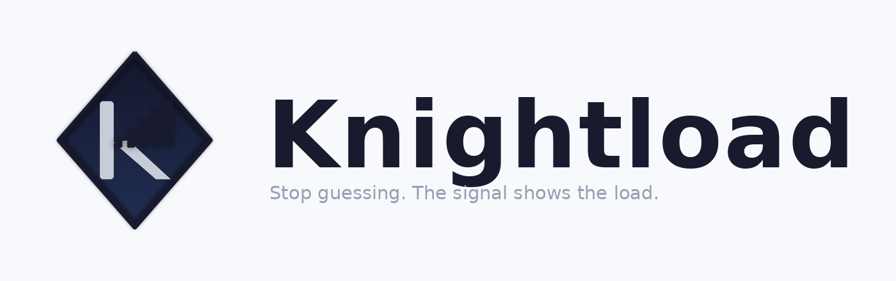
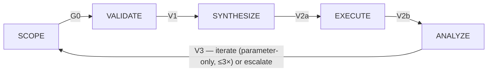
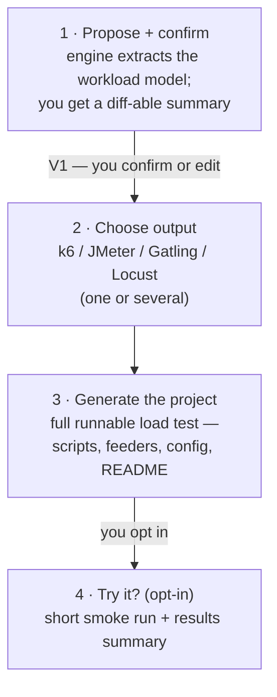
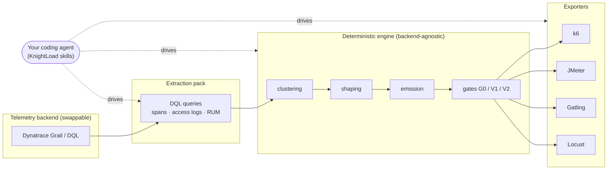

<div align="center">

<picture>
  <source media="(prefers-color-scheme: dark)" srcset=".github/assets/knightload-lockup-horizontal.svg">
  <source media="(prefers-color-scheme: light)" srcset=".github/assets/knightload-lockup-horizontal-onlight.png">
  
</picture>

### Realistic, human-approved load tests — extracted from your own telemetry

**KnightLoad turns your observability data into realistic, human-approved load tests —
with a mandatory human gate and traffic you can always tell apart.**

[](LICENSE)
[](https://github.com/henrikrexed/AI-Performance-Testing/releases)
[](https://github.com/henrikrexed/AI-Performance-Testing/pkgs/container/ai-performance-testing)
[](https://henrikrexed.github.io/AI-Performance-Testing/)

</div>

---

One idea sits under all of it: **your telemetry already knows what your real workload
looks like — extract it, have a human approve it, then replay it faithfully.**

Maintained by [Henrik Rexed](https://www.youtube.com/@IsItObservable) (IsItObservable).
The methodology and toolkit were developed and battle-tested on the
[IsItObservable](https://www.youtube.com/@IsItObservable) channel's cloud-native and AI
benchmarking projects.

## The loop



| Stage | What happens | Who owns it |
|---|---|---|
| **SCOPE** | extraction queries over a clean telemetry window → journeys, arrival profiles, think-times, payload strategy (`workload-model.json`) | you / your coding agent |
| **VALIDATE** | a human reads `scenario-proposal.md` and approves, adjusts, or rejects — recorded in the model, revision-bound | **a human, always** |
| **SYNTHESIZE** | approved model → runnable k6 / JMeter / Gatling / Locust project + synthetic payload pools (V2a static checks) | you / your agent |
| **EXECUTE** | small confirmation test first (six pass criteria), then a capped, abort-guarded full run | you / your agent |
| **ANALYZE** | shape-diff of test vs baseline across six dimensions → accept / iterate / escalate | machine + human cap |

Why it is built this way:

- **Realism is measured, not guessed** — journeys, arrival rates, and think-times come
  from your own telemetry (spans, access logs, RUM sessions, OTel `session.id`). Nothing
  is assumed where a number can be extracted.
- **A human gate is mandatory** — no test runs against any environment before a person
  approves the workload model (Gate V1). Approval is bound to the exact model revision;
  edit the model and the approval is void. Fail-closed everywhere downstream.
- **Tests are code you can read** — every generated test is committed, diffable, and
  reviewable. Regeneration is deterministic given the same model and seed — no black-box
  recorder, no artifact you can't inspect.
- **Synthetic traffic stays identifiable** — generated load carries `synthetic=true`
  baggage promoted to a queryable attribute, so test and real traffic never blur — even
  when they share an environment.

## How you use it — the guided flow

You don't run a pile of scripts by hand. You talk to your coding agent (Claude Code,
opencode, Cursor, …); **KnightLoad drives the engine and stops at exactly the human
decision points.** Four steps, mapped 1:1 onto the loop:



| Step | What happens | Loop stage | Who decides |
|---|---|---|---|
| **1 · Propose + confirm** | The agent runs the engine to extract/propose the workload model from your telemetry (or the bundled synthetic extract) and shows it as a readable summary — endpoints, mix %, arrival/ramp, think-times. | SCOPE → **V1 gate** | **you** (the gate) |
| **2 · Choose output** | The agent asks which exporter(s) you want — **k6 / JMeter / Gatling / Locust**, one or several. Sane default: k6. | VALIDATE | you pick |
| **3 · Generate the project** | The agent renders the full, runnable load-test project for the chosen exporter(s) into a named folder (e.g. `loadtest-<app>/`) with a one-line "how to run". | SYNTHESIZE | agent / engine |
| **4 · "Try it?"** | The agent offers to run a short smoke test and summarize the results. Optional and user-gated. | EXECUTE → ANALYZE | you opt in |

The honest shape: **the agent proposes, you confirm, the engine generates, the run is
opt-in.** Nothing executes against any environment until you say so.

## Install — two commands

Get the tool, run `init`, done — then talk to your agent. No manual symlinking of skills.

```sh
# 1 — get the tool (engine + skills)
curl -fsSL https://henrikrexed.github.io/AI-Performance-Testing/install.sh | sh

# 2 — install the skills into your coding agent, verify, and print the next prompt
knightload init
```

> **Rolling out:** the one-line installer and the `init` command ship with the engine's
> onboarding work that is landing now. **On today's [`v0.1.0`](https://github.com/henrikrexed/AI-Performance-Testing/releases) release,** grab the
> `workload-engine` binary (linux / macOS / windows) or the multi-arch image
> `ghcr.io/henrikrexed/ai-performance-testing`, or `git clone` for source — then install
> the skills per [`docs/skills-install.md`](docs/skills-install.md). All engine paths are
> in [`docs/engine.md`](docs/engine.md).

### Try it with no backend (~10 minutes)

Run the first half of the loop on the bundled synthetic example — no tenant, no tokens:

```sh
git clone https://github.com/henrikrexed/AI-Performance-Testing.git
cd AI-Performance-Testing

# SCOPE: synthetic extraction → a G0-validated model + a human-readable proposal
(cd skills/workload-model && python3 scripts/build_example.py \
  && cat out/example-frontend/scenario-proposal.md)

# SYNTHESIZE: turn the committed example model into a runnable k6 script (V2a gate)
(cd skills/k6-synthesis \
  && node bin/synthesize.mjs ../../examples/workload-model.example.json /tmp/example-out)
```

Read the proposal, then look at what SYNTHESIZE generated — this is also where you see the
V1 gate in action: synthesis **refuses** a model that hasn't been approved. Continue in
[`tutorial/README.md`](tutorial/README.md) for the full walkthrough.

## Exporters

One approved model renders to any of four industry-standard runners — pick per prompt:

| Exporter | What you get |
|---|---|
| **k6** | The native fit — open & closed arrival, Zipf payload pools. |
| **JMeter** | Concurrency Thread Group + Throughput Shaping Timer, CSV data sets. |
| **Gatling** | A single Scala Simulation with JSON feeders. |
| **Locust** | `locustfile.py` with `LoadTestShape` pacing and shared feeders. |

## How it fits together

The deterministic core is backend-agnostic. Today the extraction and analysis seam is
Dynatrace (Grail/DQL); the clustering / shaping / emission / gates don't care where the
data came from, and the generated tests are plain runner projects that run anywhere.



## Documentation

| Doc | What it covers |
|---|---|
| [`docs/methodology.md`](docs/methodology.md) | The method: principles, the five-stage loop, every gate, dual-source session reconstruction, safety rules, fidelity caveats |
| [`docs/usage.md`](docs/usage.md) | End-to-end usage — no-backend quickstart, running the loop against your own tenant, the full tutorial |
| [`docs/engine.md`](docs/engine.md) | The workload-model engine: install per platform (binary / Docker / k8s / source) and its role in the loop |
| [`docs/requirements.md`](docs/requirements.md) | Dynatrace tokens + **scopes**, `dtctl` + its agent skill, Davis AI, everything else |
| [`docs/skills-install.md`](docs/skills-install.md) | Installing the skills into Claude Code, opencode, Cursor, or any agentskills.io agent |

The full documentation site lives at
[**henrikrexed.github.io/AI-Performance-Testing**](https://henrikrexed.github.io/AI-Performance-Testing/).

## Configuration

All environment wiring is documented in [`.env.example`](.env.example) — copy to `.env`,
fill in your values, never commit a real `.env`. Two tokens by design: a read-only DQL
token and a separate OTLP ingest token. The exact **token scopes** (including
`storage:user.events:read`, the one that is easy to miss for RUM-driven journeys) and the
`dtctl` setup are in [`docs/requirements.md`](docs/requirements.md).

The backend is currently **Dynatrace (Grail/DQL)** for extraction and analysis. The
deterministic core (clustering, shaping, emission, gates) is backend-agnostic — the DQL
pack is the seam you would reimplement for another backend. Generated tests are plain
k6 / JMeter / Gatling / Locust projects and run anywhere those runners run.

## Requirements

- Python 3.11+, Node.js 20+, k6 (only for EXECUTE; skills degrade to `node --check`)
- A Dynatrace environment (trial works) for the live loop — tokens + scopes in
  [`docs/requirements.md`](docs/requirements.md)
- Each `skills/*/` directory is self-contained with its own tests:
  `python3 -m pytest` / `node --test` inside it

## License

[MIT](LICENSE) — © 2026 Henrik Rexed.
