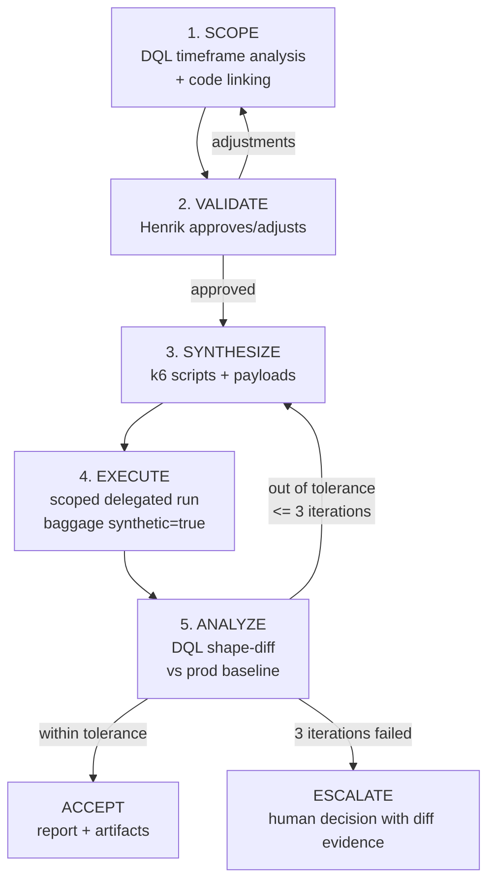

# AI-Driven Load-Testing Methodology

*ISI-4045 · Phase 2 of the PAC "Loadtesting & AI" track ([ISI-4032](/ISI/issues/ISI-4032), plan rev 1, approved 2026-09-08)*
*Builds on: [`research/loadtesting-from-observability.md`](../research/loadtesting-from-observability.md)*

**Version:** 0.3 (draft, all-gaps-closed) · **Status:** awaiting board validation (Gate V1) on this document itself — we apply the methodology to its own delivery: nothing is "final" until a human validates it.

---

## 1. Purpose & principles

This document formalizes the loop for producing load tests that reflect production reality, with AI agents doing the telemetry analysis, test synthesis, execution, and diffing — and humans keeping the judgment calls.

Three pillars (from the approved plan):

1. **Delegate execution & analysis, not judgment.** Scoped agent runs already executed and analyzed our fluent-bit, otel-collector, and MemoryServer benchmarks (see Phase 1 evidence pack, `docs/evidence/`). The scope contract — inputs, guardrails, human gates — is the pattern this methodology generalizes.
2. **Code-driven test authoring only.** Tests live as code (k6 primary; Gatling/Locust supported alternatives), versioned in git, reviewable, CI-runnable. No black-box recorders.
3. **Observability defines the scope.** Dynatrace + dtctl (DQL) analyze a traffic timeframe → extract the most regular traces/journeys → link journeys to code → propose a test scenario → **the user validates it before anything runs**.

Operating principles (normative — "MUST"):

- **P1 — Human gate is mandatory.** No test executes against any environment before the workload model is explicitly approved by the responsible human (Gate V1). Never skipped, never retro-active, never auto-approved by telemetry or agent heuristics.
- **P2 — Tests are code.** Every generated artifact is committed, diffable, and reviewable. Regenerating must be deterministic given the same workload model + seed.
- **P3 — Every number comes from telemetry.** Rates, mixes, latencies, and payload shapes are derived from observability data. LLM-assisted synthesis is always shape-validated against baselines; hallucinated patterns are rejected, not patched by hand-waving.
- **P4 — Test traffic is always identifiable.** All generated requests carry OTel baggage `synthetic=true` (propagated as the W3C `baggage` header) so test and production telemetry can be separated in DQL. **Prerequisite (O11y):** baggage is a context-propagation mechanism and is *not* a queryable span attribute by default — the pipeline MUST promote it to a span/resource attribute so DQL can filter on it (SDK baggage span processor, or the collector `baggage`/`transform` processor copying `baggage.synthetic` → attribute `synthetic`). If this promotion is not in place, the ANALYZE filter (§3.5) matches nothing. See §7.7.
- **P5 — Never production by default.** Targets MUST come from a non-production allowlist. Any production exception requires an explicit board approval recorded on the issue.

---

## 2. The loop at a glance



| # | Stage | Owner | Consumes | Produces | Exit gate |
|---|-------|-------|----------|----------|-----------|
| 1 | SCOPE | agent (workload-model skill) | DQL baseline queries, service code | `workload-model.json`, `scenario-proposal.md` | **G0** machine checks |
| 2 | VALIDATE | **human** (Henrik) | `scenario-proposal.md` | approval record in model `status.approval` | **V1** scenario approval |
| 3 | SYNTHESIZE | agent (k6-synthesis skill) | approved `workload-model.json` | `k6/*.js`, `payloads/*`, static-check pass | **V2a** static checks |
| 4 | EXECUTE | agent (loadtest-run skill, scoped run) | k6 scripts, `run-config.json` | run telemetry, `run-report.md` | **V2b** pre-flight safety |
| 5 | ANALYZE | agent (baseline-diff skill) | test telemetry, prod baseline | `shape-diff.json`, accept/iterate decision | **V3** shape tolerance |

The loop is **per target service, per scenario**, and each turn of the loop is a numbered run under `loadtests/<target>/runs/`.

---

## 3. Stage specifications

Each stage below is specified tightly enough to build a skill/MCP against (see §8): inputs, procedure, outputs, exit criteria, and the skill boundary.

### 3.1 SCOPE — observability-driven workload modeling

**Objective:** derive a workload model (arrival profile + weighted journeys + payload specs) from a production telemetry timeframe, linked to code.

**Inputs:**
- Dynatrace environment (dtctl profile) — **the target service is NOT assumed up front; SCOPE discovers it** (see step 2a)
- analysis timeframe (default: last 7 days, peak-inclusive; MUST exclude deploy windows and incidents)
- repo/commit of the service code (for journey→code linking)

**Procedure:**
1. **Timeframe sanity** — confirm the window is deploy-free and incident-free (DQL on deployment events / problem records). If not, shrink or shift and record why in the proposal.
2. **Baseline extraction** (DQL via dtctl; validated query pack — see `docs/phase4-t0-dql-validated.md` and `docs/phase-g1g3-observability-extraction.md` for live-validated field names):

   **2a. Front-end discovery (G1 — new).** The agent identifies the service that originates application traffic from the span graph — it is not told the front-end in advance.

   - **Step 1 — attribute each trace to its earliest-starting root span** (not raw root-span count, which is unreliable under trace fragmentation — a single `trace.id` can carry many `is_root_span==true` spans):
     ```sql
     -- G1-C: entry point = earliest-start root span per trace
     fetch spans, from: -2h
     | filter request.is_root_span == true
     | sort start_time asc
     | summarize entryService = takeFirst(service.name),
                 entryOp      = takeFirst(span.name),
       by: { trace.id }
     | summarize traces = count(), by: { entryService, entryOp }
     | sort traces desc
     ```
     *Note: use `request.is_root_span == true` (validated); `isEntrySpan()` is illustrative only and must be confirmed against the target tenant. `start_time`/`end_time` are the usable timestamps; `timestamp` is typically empty on spans.*

   - **Step 2 — apply noise classifier.** From the ranked `(entryService, entryOp)` list, drop:
     - operational endpoints: `GET /health`, `/healthz`, `/livez`, `/readyz`, `GET /metrics`
     - infra polling: `flagd *.Service/*`, config/stream endpoints
     - async consumers: `span.kind == "consumer"` (Kafka `receive`, order events, etc.)

   - **Step 3 — tiebreak between load driver and edge server.** If a synthetic load driver is present (op names like `user_*`), **prefer it only in non-production analysis windows** (driver names are human-legible journeys). For any window modelling production traffic, fall through to the edge server (`span.kind == "server"`, names like `*-proxy`, `*gateway`, `ingress`). Confirm with downstream service-graph reach via a `join` query.

   - **Baseline extraction (entry operations by volume):**
     ```sql
     -- validated equivalent of the former isEntrySpan() query
     fetch spans, from: -7d
     | filter request.is_root_span == true and service.name == $entryService
     | summarize calls = count(), by: { span.name }
     | sort calls desc | limit 25
     ```

   - Arrival curve (per-minute request rate at entry — also used for ramp extraction in step 5):
     ```sql
     fetch spans, from: -7d
     | filter request.is_root_span == true and service.name == $entryService
     | makeTimeseries count(), interval: 1m
     ```
     *Grail caveat: `makeTimeseries`/`bin` snaps the interval upward over long windows (~1000-bucket cap). Read the returned interval; do not assume the requested granularity.*

   - Latency and error baseline per entry operation (**use the server-side span, not the load-driver wrapper** — the wrapper bakes in client think-time, which inflates concurrency estimates ~1000×):
     ```sql
     fetch spans, from: -7d
     | filter span.kind == "server" and service.name == $frontendServer and span.name == $op
     | summarize p50 = percentile(duration, 50)/1000000.0,
                 p95 = percentile(duration, 95)/1000000.0,
                 p99 = percentile(duration, 99)/1000000.0,
                 err = count(error)
     ```
     Store p99 in the baseline (§4); it drives abort thresholds (§3.4). When server p99 is anomalously high (e.g. > 10 s), record it and set abort thresholds above that value rather than below.

   - Service-graph fan-out (downstream call edges and rates from traces).

3. **Journey extraction and scenario clustering to 1–6 named scenarios (G1 — new).**
   - Rank filtered entry operations by volume. Accumulate until cumulative weight ≥ **80%** of application entry traffic (coverage rule). Record per-journey weight and think-time distribution from inter-span gaps.
   - **Think-time per journey:** `think_time = load_driver_wrapper_duration − server_response_time`. This recovers the per-journey think-time distribution directly from telemetry for `spec.journeys[].steps[].thinkTime`.
   - **Cap to ≤6 named scenarios.** Merge journeys that share a structural fan-out signature **and** a semantic op-name stem: merge if Jaccard(downstream-service-set_A, downstream-service-set_B) ≥ 0.6 **and** op-name stems agree (or the operator confirms). The merged cluster inherits the sum of its members' weights. Record each scenario's cumulative weight in `spec.journeys[].weight`. Keep cumulative coverage ≥ 0.80 after merging; if coverage would drop below, do not merge.
   - If a tenant yields >6 clusters after merging, drop the lowest-weight tail clusters while cumulative weight stays ≥ 0.80, and record the dropped tail in the proposal.
   - Scenarios with structurally unique fan-out (e.g. a full transactional checkout with reach >10 services) MUST NOT be merged even if weight is low, because they represent the highest-risk code paths.

4. **Code linking** — for each journey step, locate the implementing code (route handler, client call, DB/mq statement) via code search; record `codeRef` (`path#symbol`). Journeys that cannot be linked are flagged `unlinked: true` and MUST be called out in the proposal.

5. **Arrival model fit, concurrency, and ramp shaping (G3 — new).**
   - **Pace (TPS/TPM) per scenario:** entry-trace count ÷ window, summed over the cluster's member ops (query G3-A). Note whether the tenant reported `Sampled: no`; if sampling is active, apply a sampling-correction factor before the division.
   - **Concurrency (Little's Law):** `concurrency ≈ arrival_rate × mean_server_response_time`. The response-time term MUST come from the **server-side entry span** (not the load-driver wrapper). Open model (arrival-rate executors) for public/queuing APIs; closed model (VU-based) for seat-limited systems: `VUs ≈ arrival_rate × (server_response_time + think_time)`. Deviations > 2× flag a modeling error.
   - **Ramp-up / ramp-down shaping:** compute CoV = stddev ÷ mean of the per-minute arrival curve.
     - **CoV < 0.15** → steady traffic: emit a single `constant-arrival-rate` stage with `shape: "steady"`.
     - **CoV ≥ 0.15** → extract the ramp: identify the global-peak minute; the monotone-rising prefix = ramp-up, the monotone-falling suffix = ramp-down, the middle = plateau. Piecewise-linear-segment the curve to **≤6 `ramping-arrival-rate` stages** (per segment: `rate` = segment mean, `duration` = segment length). Record both ramp-up and ramp-down tails in `spec.arrivalProfile.stages`.
   - The `arrivalProfile.littlesLawCheck` block MUST be populated with `expectedConcurrency`, `observedConcurrency`, and `ratio`.

6. **Emit artifacts** — `workload-model.json` (schema §4) + `scenario-proposal.md` (template §5.2).

**Outputs:** `workload-model.json`, `scenario-proposal.md`.

**Exit criteria — Gate G0 (machine-checkable, enforced before VALIDATE is offered):**
- [ ] `workload-model.json` validates against the schema in §4
- [ ] cumulative journey weight ≥ 0.80 (coverage) — actual value recorded in `spec.coverage`
- [ ] number of journeys ∈ [1, 6]
- [ ] every journey has `codeRef` per step, or explicit `unlinked: true` with reason
- [ ] every journey carries a `baseline` (p50/p95/p99/error-rate) sourced from the server-side span
- [ ] arrival profile passes the Little's-Law sanity check (`ratio` ∈ [0.5, 2.0])
- [ ] every `dependsOn` step edge has a `correlates` entry specifying the data-flow (source, extract, inject) — see §4
- [ ] `spec.payloads` entries with `cacheProfile.targetHitRatio > 0` carry a `keyCardinality` calculation — see §4
- [ ] proposal names target environment from the allowlist and the requested blast-radius caps
- [ ] all DQL queries have been run live against the target tenant and field names confirmed

**Skill boundary (Phase 3 input):** dtctl/DQL query pack (G1-C, G3-A, G3-B, latency, fan-out) + timeframe sanity; front-end discovery + noise classifier; span-tree journey extraction + Jaccard clustering to ≤6 scenarios; think-time recovery; CoV-gated ramp extraction; code-search linking; model emission + G0 self-validation.

### 3.2 VALIDATE — mandatory human gate

**Objective:** the responsible human approves or adjusts the proposed scenario before any code is synthesized or run.

**Rules (normative):**
1. The gate decision MUST be captured as a structured, recorded confirmation (e.g., Paperclip `request_confirmation`) bound to a specific `workload-model.json` revision id — not a chat remark.
2. Approval is **hash-bound**: any change to the model after approval invalidates the approval and re-opens the gate. The agent applies adjustments as a **new revision**, which requires a **new confirmation**.
3. The approval trail is recorded in the model itself: `status.approval = { revision, decisionBy, decisionAt, decision: "approved" | "adjusted" }`.
4. **No auto-approval.** Telemetry similarity, agent confidence, deadline pressure, or repeated iterations MUST NOT satisfy this gate. Only an explicit human decision does.
5. Scope of approval = the scenario (target env, journey set + weights, arrival profile, payload specs, caps). Later parameter-level tuning during ANALYZE iterations (§3.5) does not re-open the gate; structural changes (journeys, weights, rates, target) always do.

**Skill boundary:** none — this is a Paperclip interaction, deliberately not a skill.

### 3.3 SYNTHESIZE — code-driven test authoring

**Objective:** generate versioned, reviewable load-test code from the approved model.

**Rules:**
1. **k6 primary.** Gatling (Scala) / Locust (Python) only when `run-config.tool` explicitly selects them; the model is tool-agnostic, generators are per-tool.
2. **Executor mapping.** One k6 *scenario* per journey group. Executor choice per model:
   - Open model: `constant-arrival-rate` (steady) or `ramping-arrival-rate` (piecewise stages from §3.1 ramp extraction). The `preAllocatedVUs` ceiling must accommodate the ramp peak.
   - Closed model (VU-bound): `constant-vus` (steady) or `ramping-vus` with matching stage profile.
   - **Ramp-down tail:** the final stage in a `ramping-arrival-rate` / `ramping-vus` config MUST reach `rate: 0` / `target: 0` over a realistic cool-down duration (default: same duration as the ramp-up). Do not end a ramping test at peak rate.
   - Assert `dropped_iterations == 0` during steady stages; non-zero dropped iterations mean `preAllocatedVUs` is too low for the target rate.
3. **Request chaining and correlation (G2 — new).** A journey is **one correlated session per VU-iteration**, not N independent requests.
   - **Iteration = session.** Per-iteration local variables hold correlated state (session cookie, auth token, cart/order id). Never hold session state in module scope (cross-VU bleed).
   - **Cookie isolation.** k6's cookie jar persists across iterations per VU by default. To model a fresh user per journey, reset it each iteration (`http.cookieJar().clear(url)` or a fresh `new http.CookieJar()`).
   - **Correlation = extract → inject.** Each `dependsOn` edge in `spec.journeys[].steps[]` is a data-flow edge specified by the `correlates` field (see §4 schema). Implementation: extract from the prior response (JSON path, response header, HTML field via `findBetween`); inject into the next request (auth header, path parameter, request body).
   - **Wrap each step in `group('stepId')`** so k6 metrics and OTel span names are per-step, feeding the §3.5 per-step latency shape-diff.
   - **Fail the chain on broken correlation.** If an extract yields null (missing token, id, etc.), fail the iteration immediately (`fail()` / early return). A chain that continues with garbage data inflates downstream counts and corrupts the fan-out diff. This is the primary source of unrealistic chains and MUST be enforced.
4. **Synthetic payloads and cache-avoidance dataset strategy (G4 — new).** Payloads are never sampled from production data; generators are PII-free by construction; random seeds recorded for determinism.
   - **Goal: reproduce production's cache behaviour, not eliminate caching.** A test with all-unique keys overstates backend load; a test with a single key understates it. The payload pool MUST reproduce production's cache hit ratio (from telemetry) by matching the key-reuse (popularity) distribution and working-set size.
   - **Sizing math.** Let `R` = target RPS, `D` = run duration (s), `T` = cache TTL (s), `m_prod` = production miss ratio for the endpoint.
     - Minimum unique-key pool size to avoid forced all-hits inside one TTL: `K ≥ R × T × m_prod`.
     - For a "no key reused in the same TTL window" guarantee: `K ≥ R × T`.
     - For one-pass uniqueness across the full run: `K ≥ R × D`.
     - Birthday-bound intuition: drawing `N` requests from `K` uniform keys yields ≈ `N²/(2K)` repeats — forced uniqueness is quadratically expensive and typically impractical for long runs.
   - **Popularity distribution.** Fit the key-access distribution to production telemetry. The existing `payloadSpec.distribution` enum already includes `"zipf"` — use it with a fitted `α` parameter (from cache-hit-rate telemetry). Zipf ≈ 1 reproduces a typical web workload where ~0.6% of keys yield >80% hit ratio.
   - **Seeded backing store.** The target's database/store MUST be seeded to production volume before the test run. An empty store produces unrealistic query plans, buffer cache behaviour, and lock contention — a service that handles 3 000 RPS on an empty DB may sustain only 600–1 000 RPS under realistic data.
   - Record `spec.payloads.<pool>.cacheProfile` (see §4 schema) with `targetHitRatio`, `keyCardinality`, and `distributionAlpha` so the §3.5 ANALYZE pass can add a cache-hit-ratio dimension.
5. LLM assistance is allowed for authoring, but output MUST pass static checks (Gate V2a) and, later, the shape-diff (Gate V3). A hallucinated endpoint/parameter fails V2a and is rejected.
6. Test code carries the identity header by construction: `baggage: synthetic=true` on every request (k6 OTel extension / `k6/x/tracing`).

**Exit criteria — Gate V2a (static, pre-run):**
- [ ] `k6 inspect`/parse succeeds (or selected tool's syntax check)
- [ ] every request in scripts carries `baggage: synthetic=true`
- [ ] all referenced payload pools exist and match their specs
- [ ] declared max rate/VU ≤ caps from the approved model
- [ ] every `dependsOn` step produces a `correlates` extract; its downstream step fails fast if the extract is null
- [ ] all ramping scenarios end with a ramp-down stage reaching `rate: 0` / `target: 0`
- [ ] scripts committed to the repo (tests are code)

**Skill boundary:** model→k6 codegen; payload pool generation (Zipf/empirical sampling, key-cardinality sizing); G2 correlation chain generation; V2a checker.

### 3.4 EXECUTE — small confirmation test, then full delegated run

**Objective:** first prove the model at low blast radius (G5 — small confirmation test), then run the full synthesized test exactly as scoped.

#### 3.4.1 Small confirmation test (G5 — new, mandatory pre-step)

**Purpose:** a first-class, low-blast-radius smoke run that validates the model *before* the full test. The agent checks its own homework. If the confirmation test fails, the model is revised (not the full test run).

**Confirmation test parameters:**
- **Duration:** 3–5 minutes (default).
- **Scale:** 10–20% of the approved target RPS / VU count.
- **Scope:** all journeys are exercised, in their approved weight ratios.
- **Pass criteria (all six must hold — V2b-smoke gate):**
  1. Zero 5xx errors (or ≤ the per-journey `baseline.errorRate` from the model).
  2. Every journey step reaches a downstream span in the service graph (no broken routes / 404s).
  3. Chain correlation succeeds for every step that has a `correlates` data-flow edge — zero null-extract failures.
  4. Journey mix (distribution over journeys) matches approved weights within TVD ≤ 0.30 (relaxed from V3's 0.15 at reduced scale).
  5. At least one `synthetic == true` span appears in Dynatrace (proves baggage promotion is in place before the full test).
  6. `dropped_iterations == 0` at the target-scale rate, confirming `preAllocatedVUs` is sufficient.

If any criterion fails: diagnose, revise the model (structural → back to **VALIDATE**; parameter-only → may iterate without re-validation, see §3.5 iteration rule), and re-run the confirmation test before proceeding. Maximum **2** confirmation retries; on the 3rd failure, escalate to the human.

#### 3.4.2 Full run

**Rules:**
1. Execution is a **scoped agent run** with a written scope contract: inputs, allowed commands, blast-radius caps, abort conditions, output location.
2. `run-config.json` (template §5.3) fixes the blast radius: target env (from allowlist), max RPS, max VUs, duration cap, schedule window, and abort thresholds (error-rate > X% or p95 > Y ms → kill). Abort threshold for p99 MUST be set above the `baseline.p99Ms` recorded in the model (not below it).
3. Target MUST be on the non-production allowlist (P5). The runner refuses otherwise.
4. Telemetry emitted through the OTel pipeline with `synthetic=true` baggage, so ANALYZE can select test traffic precisely.
5. The run records its telemetry coordinates (environment, timeframe, trace filter) for ANALYZE.

**Exit criteria — Gate V2b (pre-flight, machine-enforced immediately before full run start):**
- [ ] target env ∈ allowlist and ≠ production
- [ ] V2a passed on the exact commit being run
- [ ] model `status.approval.decision == "approved"` for the model revision the scripts were generated from
- [ ] caps and abort thresholds loaded and armed; p99 abort threshold ≥ `baseline.p99Ms`
- [ ] **small confirmation test passed (all 6 criteria)**
- [ ] run directory created (`runs/<UTC-timestamp>/`)

**Skill boundary:** scoped-run executor (confirmation test + full run); caps/abort supervisor; confirmation-test pass-criteria checker; run-report generation.

### 3.5 ANALYZE — shape-diff against production, then iterate

**Objective:** prove (or disprove) that the test traffic *shape* matches the production baseline, in Dynatrace DQL.

**Telemetry prerequisites (O11y — enforce before trusting any diff):**
1. **Synthetic tag is queryable.** The `synthetic` attribute (promoted from baggage per P4) MUST be present on test spans. The runner asserts a non-zero count of `synthetic == true` spans in a warm-up probe before the diff is computed; zero means the promotion step is missing, not that shapes match.
2. **Sampling parity.** Compare *rates*, not raw counts, and normalize for the sampling ratio of each dataset. If production is head/tail-sampled at ratio `s_prod` and the test at `s_test`, arrival-shape and fan-out comparisons use sampling-corrected rates; the applied `samplingFactor` is recorded in `shape-diff.json`. Mismatched, unrecorded sampling is the most common false "out of tolerance".
3. **Scale factor is explicit.** When the test runs at reduced scale, the arrival-shape comparison divides the baseline by a recorded `scalingFactor` (test target RPS ÷ baseline RPS); it is stored in `shape-diff.json`, never inferred silently.

> **DQL validation gate (updated §3.1 now provides live-validated queries).** All queries in this methodology (§3.1 and below) have been validated against a live Dynatrace tenant (oat05854, 2026-10-09). The key field names are: `request.is_root_span` (not `isEntrySpan()`, which is illustrative only), `span.kind`, `duration` in nanoseconds, `start_time`. Any new target tenant MUST have its field names re-confirmed before the queries are run in production.

**Shape-diff dimensions and default tolerances** (overridable via `run-config.tolerances`):

| Dimension | Comparison | Default tolerance |
|---|---|---|
| Arrival shape | per-minute RPS curve, test (scaled) vs baseline | WMAPE ≤ 0.20 |
| Latency | p50 / p95 / p99 per journey entry op | \|Δp50\| ≤ 25%, \|Δp95\| ≤ 30%, \|Δp99\| ≤ 35% relative |
| Service fan-out | baseline downstream edges present during test | ≥ 90% of edges present; per-edge rate ratio ∈ [0.5, 2.0] |
| Error rate | test vs baseline, per journey | absolute Δ ≤ +1.0 pp |
| Journey mix | distribution over journeys vs weights | total variation distance ≤ 0.15 |
| **Cache hit ratio** (G4 — new, when `cacheProfile.targetHitRatio` set) | per-endpoint cache hit ratio, test vs baseline | \|Δhit-ratio\| ≤ 0.10 absolute |

**Decision rule:**
- **All dimensions within tolerance → ACCEPT.** Emit `shape-diff.json` + summary in `run-report.md`; loop turn is complete.
- **Any dimension out → ITERATE.** Classify the miss (shape / latency / fan-out / mix), adjust **parameters only** (think times, pacing, payload pools, per-journey pacing within ±10% of approved weights), re-run SYNTHESIZE→EXECUTE→ANALYZE. Structural fixes (journeys, weights, rates, target) require a model change → back to **VALIDATE** (rule §3.2.2).
- **Iteration cap:** max **3** iterations. On the 4th miss → **ESCALATE** to the human with the diff evidence and a diagnosis; no silent tuning forever.

**Skill boundary:** DQL diff queries (filtered by `baggage synthetic=true` vs baseline window), tolerance evaluation, iteration classifier, escalation report.

---

## 4. Workload-model JSON schema (draft v1)

Draft-07 JSON Schema, **v0.3**. Stored as `loadtests/<target>/workload-model.json`. The `status` block is agent-maintained and carries the Gate V1 trail. **Changes from v0.2:** added `correlates` to `steps` (G2 data-flow), `cacheProfile` to `payloadSpec` (G4), `shape` flag on `arrivalProfile.stages` (G3).

```json
{
  "$schema": "http://json-schema.org/draft-07/schema#",
  "$id": "https://github.com/henrikrexed/PAC-AI-loadtesting/schemas/workload-model.schema.json",
  "title": "WorkloadModel",
  "type": "object",
  "required": ["apiVersion", "kind", "metadata", "spec", "status"],
  "properties": {
    "apiVersion": { "const": "loadtest.isi/v1alpha1" },
    "kind": { "const": "WorkloadModel" },
    "metadata": {
      "type": "object",
      "required": ["name", "targetService", "environment", "source"],
      "properties": {
        "name": { "type": "string", "pattern": "^[a-z0-9][a-z0-9-]*$" },
        "targetService": { "type": "string" },
        "environment": { "type": "string", "description": "Dynatrace environment/tenant name analyzed" },
        "generatedAt": { "type": "string", "format": "date-time" },
        "source": {
          "type": "object",
          "required": ["tool", "timeframe"],
          "properties": {
            "tool": { "type": "string", "examples": ["dynatrace-dql", "dtctl"] },
            "timeframe": { "type": "string", "description": "ISO interval analyzed, e.g. 2026-09-01T00:00Z/2026-09-08T00:00Z" },
            "timeframeNotes": { "type": "string", "description": "deploy/incident exclusions applied" },
            "queries": { "type": "array", "items": { "type": "string" } }
          }
        }
      }
    },
    "spec": {
      "type": "object",
      "required": ["arrivalProfile", "journeys", "coverage"],
      "properties": {
        "arrivalProfile": {
          "type": "object",
          "required": ["model", "stages"],
          "properties": {
            "model": { "enum": ["open", "closed"] },
            "stages": {
              "type": "array",
              "minItems": 1,
              "items": {
                "type": "object",
                "required": ["duration", "rate"],
                "properties": {
                  "duration": { "type": "string", "examples": ["5m", "30m"] },
                  "rate": { "type": "number", "description": "target iterations/s (open) or VUs (closed)" },
                  "shape": { "enum": ["steady", "ramp_up", "plateau", "ramp_down"], "description": "G3 ramp segment type (informational)" }
                }
              }
            },
            "littlesLawCheck": {
              "type": "object",
              "properties": {
                "expectedConcurrency": { "type": "number" },
                "observedConcurrency": { "type": "number" },
                "ratio": { "type": "number" }
              }
            }
          }
        },
        "journeys": {
          "type": "array",
          "minItems": 1,
          "items": {
            "type": "object",
            "required": ["id", "weight", "entrypoint", "steps", "baseline"],
            "properties": {
              "id": { "type": "string" },
              "description": { "type": "string" },
              "weight": { "type": "number", "minimum": 0, "maximum": 1 },
              "entrypoint": { "type": "string", "description": "entry span name, e.g. POST /cart/checkout" },
              "codeRef": { "type": "string", "description": "path#symbol of entry handler" },
              "unlinked": { "type": "boolean", "default": false },
              "steps": {
                "type": "array",
                "items": {
                  "type": "object",
                  "required": ["id", "service", "operation", "callType"],
                  "properties": {
                    "id": { "type": "string" },
                    "service": { "type": "string" },
                    "operation": { "type": "string" },
                    "callType": { "enum": ["http", "grpc", "db", "mq", "cache"] },
                    "codeRef": { "type": "string" },
                    "payloadRef": { "type": "string", "description": "key into spec.payloads" },
                    "thinkTime": { "$ref": "#/definitions/thinkTime" },
                    "dependsOn": { "type": "array", "items": { "type": "string" } },
                    "correlates": {
                      "type": "array",
                      "description": "data-flow edges from prior steps (G2)",
                      "items": {
                        "type": "object",
                        "required": ["sourceStepId", "extract", "inject"],
                        "properties": {
                          "sourceStepId": { "type": "string" },
                          "extract": {
                            "type": "object",
                            "required": ["from", "path"],
                            "properties": {
                              "from": { "enum": ["body_json", "header", "body_html", "body_regex"] },
                              "path": { "type": "string" }
                            }
                          },
                          "inject": {
                            "type": "object",
                            "required": ["into", "as"],
                            "properties": {
                              "into": { "enum": ["header", "path_param", "query_param", "body_field"] },
                              "as": { "type": "string" }
                            }
                          }
                        }
                      }
                    }
                  }
                }
              },
              "baseline": { "$ref": "#/definitions/baseline" }
            }
          }
        },
        "payloads": {
          "type": "object",
          "description": "synthetic payload pools keyed by id",
          "additionalProperties": { "$ref": "#/definitions/payloadSpec" }
        },
        "caps": {
          "type": "object",
          "properties": {
            "maxRps": { "type": "number" },
            "maxVus": { "type": "number" },
            "maxDuration": { "type": "string" }
          }
        },
        "coverage": { "type": "number", "minimum": 0, "maximum": 1 }
      }
    },
    "status": {
      "type": "object",
      "required": ["revision"],
      "properties": {
        "revision": { "type": "integer", "minimum": 1 },
        "hash": { "type": "string", "description": "sha256 of canonicalized spec" },
        "approval": {
          "type": "object",
          "required": ["revision", "decision", "decisionBy", "decisionAt"],
          "properties": {
            "revision": { "type": "integer" },
            "decision": { "enum": ["approved", "adjusted"] },
            "decisionBy": { "type": "string" },
            "decisionAt": { "type": "string", "format": "date-time" },
            "confirmationRef": { "type": "string", "description": "Paperclip interaction/approval id" }
          }
        }
      }
    }
  },
  "definitions": {
    "thinkTime": {
      "type": "object",
      "required": ["distribution"],
      "properties": {
        "distribution": { "enum": ["constant", "uniform", "exponential", "empirical"] },
        "meanMs": { "type": "number" },
        "minMs": { "type": "number" },
        "maxMs": { "type": "number" },
        "samples": { "type": "array", "items": { "type": "number" }, "description": "for empirical" }
      }
    },
    "baseline": {
      "type": "object",
      "required": ["p50Ms", "p95Ms", "p99Ms", "errorRate"],
      "properties": {
        "p50Ms": { "type": "number" },
        "p95Ms": { "type": "number" },
        "p99Ms": { "type": "number" },
        "errorRate": { "type": "number", "minimum": 0, "maximum": 1 },
        "arrivalShare": { "type": "number" }
      }
    },
    "payloadSpec": {
      "type": "object",
      "required": ["fields"],
      "properties": {
        "fields": {
          "type": "array",
          "items": {
            "type": "object",
            "required": ["name", "type"],
            "properties": {
              "name": { "type": "string" },
              "type": { "enum": ["string", "int", "float", "enum", "uuid", "timestamp", "null"] },
              "generator": { "type": "string", "examples": ["random", "sequence", "faker:firstName", "const"] },
              "values": { "type": "array" },
              "distribution": { "enum": ["uniform", "weighted", "normal", "zipf"] },
              "optional": { "type": "boolean", "default": false }
            }
          }
        },
        "seed": { "type": "integer" },
        "cacheProfile": {
          "type": "object",
          "description": "G4 cache-avoidance / hit-ratio targeting",
          "properties": {
            "targetHitRatio": { "type": "number", "minimum": 0, "maximum": 1, "description": "production cache hit ratio to reproduce" },
            "keyCardinality": { "type": "integer", "description": "K = unique key pool size (derived from sizing math: R × T × m_prod at minimum)" },
            "distributionAlpha": { "type": "number", "description": "Zipf α fitted from production key-access telemetry (omit for uniform)" },
            "backingStoreSeeded": { "type": "boolean", "description": "true when the target DB/store has been seeded to production volume" }
          }
        }
      }
    }
  }
}
```

**Open schema questions (for Phase 3 / first real use):** multi-service journeys spanning Kafka topics; empirical think-time ergonomics; whether `caps` belongs in the model or only in `run-config.json` (current answer: model declares, run-config enforces).

---

## 5. Artifact formats & repo layout

### 5.1 Layout

```
docs/
  methodology.md              <- this file
  evidence/                   <- Phase 1 benchmark evidence one-pagers
  skills-mcp-decisions.md     <- Phase 3 gap analysis
research/
  loadtesting-from-observability.md
loadtests/
  <target-service>/
    workload-model.json       <- schema §4, with approval trail
    scenario-proposal.md      <- human gate V1 input
    k6/
      <scenario>.js
      lib/                    <- helpers (auth, baggage, checks)
    payloads/
      <pool>.json
    runs/
      <UTC-timestamp>/
        run-config.json
        run-report.md
        shape-diff.json
```

### 5.2 `scenario-proposal.md` template

```markdown
# Scenario proposal: <target-service> rev <N>
## What was analyzed        (timeframe, env, exclusions, coverage %)
## Journeys to be tested    (table: id, weight, entrypoint, codeRef, baseline p95)
## Arrival profile          (stages, model, Little's law check)
## Payload strategy         (pools, PII stance, seeds)
## Where it will run        (target env from allowlist, caps, abort thresholds)
## Risks & unknowns         (unlinked steps, coverage gaps, assumptions)
## Decision requested       (approve as-is / adjust: <fields>)
```

### 5.3 `run-config.json` template

```json
{
  "modelRef": { "name": "checkout", "revision": 3, "hash": "…" },
  "tool": "k6",
  "target": { "baseUrl": "https://staging.internal", "environment": "staging", "allowlist": true },
  "caps": { "maxRps": 400, "maxVus": 200, "maxDuration": "30m" },
  "abort": { "errorRateGt": 0.05, "p95MsGt": 2500 },
  "syntheticTag": { "baggage": "synthetic=true" },
  "tolerances": { "arrivalWmape": 0.20, "p95Rel": 0.30, "edgePresence": 0.90, "errorDeltaPp": 1.0, "journeyTvd": 0.15 },
  "telemetry": { "environment": "staging-dt-tenant", "timeframe": "…", "filter": "baggage synthetic=true" }
}
```

### 5.4 `shape-diff.json` template

```json
{
  "run": "<timestamp>",
  "baselineTimeframe": "…",
  "scalingFactor": 0.25,
  "samplingFactor": { "prod": 0.05, "test": 1.0 },
  "dimensions": {
    "arrivalShape":   { "metric": "wmape", "value": 0.14, "tolerance": 0.20, "pass": true },
    "latency":        { "p50Rel": 0.08, "p95Rel": 0.19, "p99Rel": 0.27, "pass": true },
    "serviceFanout":  { "edgePresence": 0.95, "rateRatioRange": [0.6, 1.8], "pass": true },
    "errorRate":      { "deltaPp": 0.3, "pass": true },
    "journeyMix":     { "tvd": 0.09, "pass": true }
  },
  "decision": "accept",
  "iteration": 1
}
```

---

## 6. Gate rules summary

| Gate | After | Type | Enforced by | Blocks until |
|---|---|---|---|---|
| **G0** model integrity | SCOPE | machine | workload-model skill (schema + coverage + ≤6 journeys + linking + Little's law + correlates + cacheProfile) | VALIDATE offered |
| **V1** scenario approval | SCOPE → SYNTHESIZE | **human** | Paperclip confirmation bound to model revision | any synthesis |
| **V2a** static checks | SYNTHESIZE → EXECUTE | machine | k6-synthesis skill (parse, baggage, pools, caps, correlates chain, ramp-down, committed) | any run |
| **V2b-smoke** small confirmation test | pre-full-run | machine | loadtest-run skill (6 pass criteria incl. `synthetic` visible, zero null-extracts, `dropped_iterations==0`) | full-run start |
| **V2b** pre-flight | full-run start | machine | loadtest-run skill (allowlist, approval-valid, caps armed, V2b-smoke passed) | process start |
| **V3** shape tolerance | ANALYZE | machine + human cap | baseline-diff skill (6 dimensions incl. cache hit ratio); iteration ≤ 3 then human | accept / escalate |

Invariant: **V1 approval hash-bound to model revision** is the anchor of the whole loop — every later gate re-verifies it (`V2b` checks `status.approval.revision` + `hash`).

---

## 7. Safety rules

1. Non-production allowlist, checked at V2b. Production exception = board approval on the issue, never agent discretion.
2. Hard caps (RPS, VUs, duration) + automatic abort thresholds on every run.
3. `baggage: synthetic=true` on 100% of generated requests (V2a-verified, V2b-armed).
4. Synthetic payloads only — production data is never copied into payload pools; generators are PII-free by construction.
5. Runs are scheduled windows, recorded with full config for replay; abort causes are part of `run-report.md`.
6. Everything committed (P2): model, scripts, payloads, configs, diffs, reports.
7. **Synthetic-tag promotion (O11y prerequisite for P4/§3.5).** The OTel pipeline MUST copy baggage `synthetic` onto spans as a queryable attribute — via the SDK baggage span processor or a collector `transform`/`baggage` processor — and a warm-up probe MUST confirm a non-zero `synthetic == true` span count before ANALYZE runs. Without this, `synthetic=true` is invisible to DQL and test/prod telemetry cannot be separated.

---

## 8. Skill mapping (input to Phase 3, [ISI-4046](/ISI/issues/ISI-4046))

| Stage | Skill (working name) | Core capabilities | Natural interface |
|---|---|---|---|
| SCOPE | `workload-model` | dtctl/DQL query pack, timeframe sanity, span-tree journey clustering, code linking, model emission + G0 | input: service + timeframe; output: `workload-model.json` + proposal |
| VALIDATE | *(none — Paperclip interaction)* | human confirmation bound to revision | `request_confirmation` |
| SYNTHESIZE | `k6-synthesis` | model→k6 codegen, payload pools, V2a checker | input: approved model; output: `k6/` + `payloads/` |
| EXECUTE | `loadtest-run` | scoped-run executor, caps/abort supervisor, run-report | input: `run-config.json`; output: `runs/<ts>/` |
| ANALYZE | `baseline-diff` | DQL diff (synthetic filter), tolerance eval, iteration classifier, escalation report | input: run + baseline; output: `shape-diff.json` + decision |

Phase 3 decides build-skill vs use-MCP per row (e.g., Grafana Assistant / Speedscale / Tracetest as buy-side alternatives for rows 2–4).

---

## 9. Relation to Phase 1 evidence (narrative coordination)

The Phase 1 evidence pack (`docs/evidence/*.md`, one-pagers for fluent-bit, otel-collector, MemoryServer — [ISI-4044](/ISI/issues/ISI-4044)) instantiates the **EXECUTE** stage pattern with existing precedents. For narrative coherence across the PAC deck:

- each evidence one-pager exposes its **scope contract** (inputs, allowed commands, outputs) → maps 1:1 to `run-config.json` + V2b;
- its **guardrails** (caps, aborts) → §7 safety rules;
- its **outcome numbers** (delegation payoff) → the "why delegate" pillar-1 argument;
- this methodology is what those one-off runs look like **generalized and gated**.

Presentation storyline: *we already delegate execution credibly (evidence) → here is the loop that makes it repeatable (this doc) → here is the tooling to make it cheap (Phase 3) → here is it working end-to-end (Phase 4 demo).*

---

## 10. Document status

- v0.1 drafted by backup_Architect, 2026-09-08, per [ISI-4045](/ISI/issues/ISI-4045).
- v0.2 O11y review by Observability Agent, 2026-09-08: added baggage→attribute promotion prerequisite (P4, §7.7), sampling-parity + explicit scaling in ANALYZE (§3.5), DQL query-validation gate note, and `scalingFactor`/`samplingFactor` in `shape-diff.json`. Review verdict: **approved from the observability standpoint; acceptance criteria met**.
- v0.3 brainstorm synthesis by BigBoss, 2026-10-09, per [ISI-5622](/ISI/issues/ISI-5622): closes G1–G5 from the four-specialist brainstorm ([ISI-5625](/ISI/issues/ISI-5625), [ISI-5626](/ISI/issues/ISI-5626), [ISI-5627](/ISI/issues/ISI-5627), [ISI-5628](/ISI/issues/ISI-5628)).
  - **G1** — front-end auto-discovery (§3.1 step 2a): earliest-start root-span + noise classifier + edge-server fallback; replaces `isEntrySpan()` with validated `request.is_root_span == true`. Journey clustering to ≤6 named scenarios via Jaccard ≥ 0.6 + op-name stem merge.
  - **G2** — request chaining and correlation (§3.3 rule 3): `correlates` field in step schema; cookie isolation; extract→inject pattern; fail-fast on broken chain.
  - **G3** — ramp-up / ramp-down shaping (§3.1 step 5 + §3.3 rule 2): CoV gate (<0.15 = steady; else piecewise-linear ≤6 stages); ramp-down tail mandatory; Little's Law sourced from server span not load-driver wrapper; `shape` flag on `arrivalProfile.stages`.
  - **G4** — cache-avoidance dataset strategy (§3.3 rule 4 + §3.5 cache-hit-ratio dimension): reproduce-production-cache-ratio goal; Zipf sizing math; `cacheProfile` in `payloadSpec` schema.
  - **G5** — small confirmation test (§3.4.1): first-class pre-full-run smoke run with 6 pass criteria incl. `synthetic==true` span presence; V2b-smoke gate added.
  - Schema delta: `correlates` on steps, `cacheProfile` on `payloadSpec`, `shape` on `arrivalProfile.stages`.
  - 4 open questions for Henrik in `docs/phase-g1g3-observability-extraction.md` §Open questions: front-end semantics in prod vs non-prod windows, ramp demo approach, Jaccard threshold tuning, think-time distribution default.
  - **Pending Gate-V1-style board validation of v0.3** — awaiting Henrik's confirmation.
- Phase 3 ([ISI-4046](/ISI/issues/ISI-4046)) consumes §8; Phase 4 demo ([ISI-4047](/ISI/issues/ISI-4047)) executes §3 end-to-end on one target; Phase 5 deck ([ISI-4048](/ISI/issues/ISI-4048)) narrates §1–§2.
