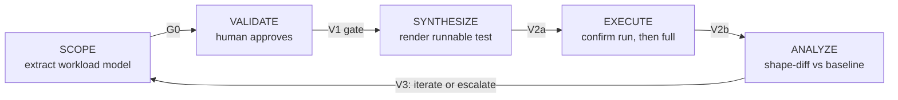
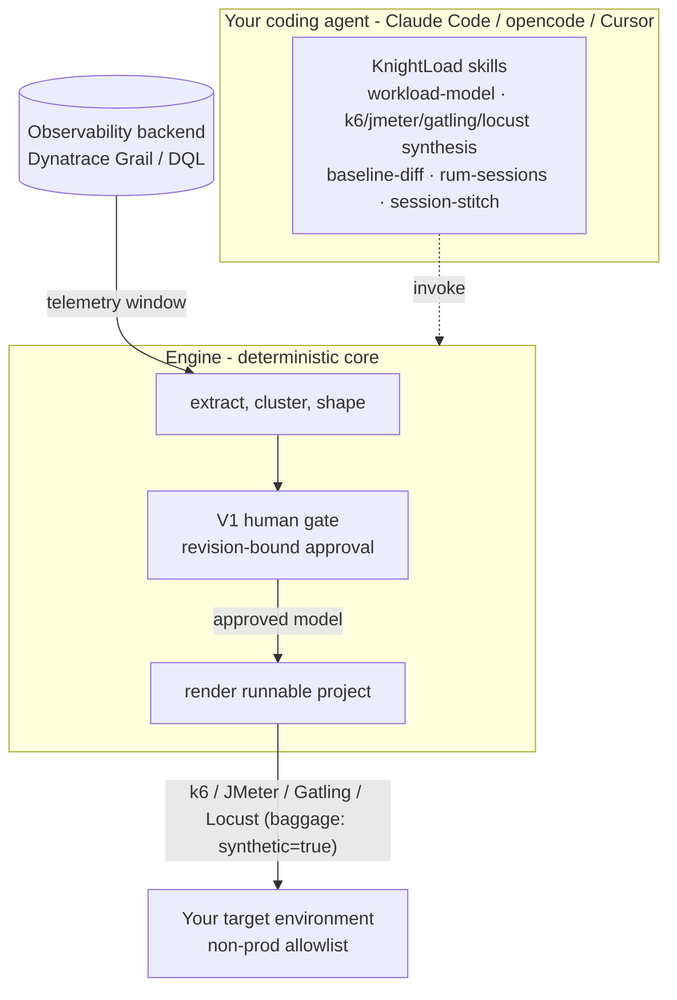

<p align="center">
  <picture>
    <source media="(prefers-color-scheme: dark)" srcset="website/static/img/logo-horizontal-onindigo.svg">
    
  </picture>
</p>

<p align="center">
  <strong>KnightLoad</strong> — Stop guessing. Load from reality.<br>
  <sub>An observability-driven, AI-agent-friendly toolkit for <strong>realistic</strong> load testing.</sub>
</p>

<p align="center">
  <a href="https://henrikrexed.github.io/AI-Performance-Testing/">Docs site</a> ·
  <a href="docs/methodology.md">Methodology</a> ·
  <a href="docs/usage.md">Usage</a> ·
  <a href="#quickstart">Quickstart</a> ·
  <a href="https://www.youtube.com/@IsItObservable">IsItObservable</a>
</p>

---

# KnightLoad — AI-Performance-Testing

An observability-driven, AI-agent-friendly toolkit for **realistic** load testing —
built around one idea: **your telemetry already knows what your real workload looks
like; extract it, have a human approve it, then replay it faithfully.**

Maintained by [Henrik Rexed](https://www.youtube.com/@IsItObservable) (IsItObservable).
The methodology and toolkit were developed and battle-tested on the
[IsItObservable](https://www.youtube.com/@IsItObservable) channel's cloud-native and AI
benchmarking projects.

## The loop



| Stage | What happens | Who owns it |
|---|---|---|
| **SCOPE** | extraction queries over a clean telemetry window → journeys, arrival profiles, think-times, payload strategy (`workload-model.json`) | you / your coding agent |
| **VALIDATE** | a human reads `scenario-proposal.md` and approves, adjusts, or rejects — recorded in the model, revision-bound | **a human, always** |
| **SYNTHESIZE** | approved model → runnable k6 scripts + synthetic payload pools (V2a static checks) | you / your agent |
| **EXECUTE** | small confirmation test first (six pass criteria), then a capped, abort-guarded full run | you / your agent |
| **ANALYZE** | shape-diff of test vs baseline across six dimensions → accept / iterate / escalate | machine + human cap |

Why it is built this way:

- **Realism is measured, not guessed** — journeys, pacing, and think-times come from
  your own telemetry (spans, access logs, RUM sessions, OTel `session.id`).
- **A human gate is mandatory** — no test runs against any environment before a person
  approves the workload model (Gate V1). Fail-closed everywhere downstream of it.
- **Synthetic traffic is identifiable** — generated load carries `synthetic=true`
  baggage promoted to a queryable attribute, so test and real traffic never blur.
- **AI does the legwork, not the deciding** — the skills are written for coding agents
  (Claude Code, opencode, Cursor, …); every consequential decision stays with a human
  or a deterministic gate.

## How it works — the guided 4-step flow

You give your coding agent a plain-language scope request
(*"scope a load test for service `checkout` over the last 3 hours"*) and it drives four
steps. **Nothing touches your system of record and no load is generated until you say
so.**



1. **Propose + confirm — the V1 human gate.** The engine extracts a workload model from a
   clean telemetry window and shows you a readable, diff-able `scenario-proposal.md`:
   journeys and weights, the open/closed arrival profile with its Little's-Law check,
   payload strategy, where it will run, and the risks. You **confirm, edit, or reject**.
   Approval is **bound to that model revision** — there is no agent self-approval, and any
   later edit invalidates a prior approval. *Nothing is generated before you confirm.*
2. **Choose output.** Pick the renderer — **k6** (default), **JMeter**, **Gatling**, or
   **Locust** — one or several. Same approved model, different runnable project.
3. **Generate.** The agent renders the full runnable test — scripts, feeders/data, config,
   and a how-to-run — from the approved model. **Every request carries
   `baggage: synthetic=true`** so the load is always distinguishable from real traffic.
4. **"Try it?" — optional smoke run.** The agent offers a short, **opt-in** smoke run
   against a non-production allowlist, under hard caps with automatic abort, and prints a
   summary. Decline and run it yourself later — the generated project is complete either
   way.

> The gate in step 1 is the point of the whole method — keep it. The smoke run in step 4
> is opt-in by design: the toolkit never fires load you did not ask for.

## Documentation

| Doc | What it covers |
|---|---|
| [`docs/methodology.md`](docs/methodology.md) | The method: principles, the five-stage loop, every gate, dual-source session reconstruction, safety rules, fidelity caveats |
| [`docs/usage.md`](docs/usage.md) | End-to-end usage — no-backend quickstart, the guided 4-step flow, running the loop against your own tenant |
| [`docs/engine.md`](docs/engine.md) | The workload-model engine: onboarding, the guided driver, install per platform (binary / Docker / k8s / source) |
| [`docs/requirements.md`](docs/requirements.md) | Dynatrace tokens + **scopes**, `dtctl` + its agent skill, Davis AI, everything else |
| [`docs/skills-install.md`](docs/skills-install.md) | Installing the skills into Claude Code, opencode, Cursor, or any agentskills.io agent |

## Quickstart

**Onboarding is two steps** — install the skills into your coding agent, then drive the
guided flow:

1. **Install the skills.** One-line install of the `workload-model` and
   `k6`/`jmeter`/`gatling`/`locust` synthesis skills into your agent's skills path — see
   [`docs/skills-install.md`](docs/skills-install.md) for the exact command per agent
   (Claude Code, opencode, Cursor).
2. **Drive the guided flow.** Ask your agent for a load test in plain language; it walks
   the four steps above, stopping at the V1 gate for your approval. The full walkthrough
   is in [`docs/engine.md`](docs/engine.md) and [`docs/usage.md`](docs/usage.md).

**Try it now — no backend, ~10 minutes.** Run the loop's first half on the bundled
synthetic example (no tokens, no live tenant):

```sh
git clone https://github.com/henrikrexed/AI-Performance-Testing.git
cd AI-Performance-Testing

# SCOPE: synthetic extraction → G0-validated model + human-readable proposal
(cd skills/workload-model && python3 scripts/build_example.py && cat out/example-frontend/scenario-proposal.md)
```

Then continue in [`tutorial/README.md`](tutorial/README.md) — including how SYNTHESIZE
refuses the model until you (the human) approve it.

**Full experience** — your own Dynatrace trial + a DeepSeek key: the tutorial deploys a
demo CrewAI agent app, generates a baseline window, and runs all five stages for real.

## Configuration

All environment wiring is documented in [`.env.example`](.env.example) — copy to `.env`,
fill in your values, never commit a real `.env`. Two tokens by design: a read-only DQL
token and a separate OTLP ingest token. The exact **token scopes** (including
`storage:user.events:read`, the one that is easy to miss for RUM-driven journeys) and the
`dtctl` setup are in [`docs/requirements.md`](docs/requirements.md).

The backend is currently **Dynatrace (Grail/DQL)** for extraction and analysis. The
deterministic core (clustering, shaping, emission, gates) is backend-agnostic — the DQL
pack is the seam you would reimplement for another backend. Generated tests are plain
k6 and run anywhere k6 runs.

## Requirements

- Python 3.11+, Node.js 20+, k6 (only for EXECUTE; skills degrade to `node --check`)
- A Dynatrace environment (trial works) for the live loop — tokens + scopes in
  [`docs/requirements.md`](docs/requirements.md)
- Each `skills/*/` directory is self-contained with its own tests:
  `python3 -m pytest` / `node --test` inside it

## Installing

- **Skills** — install `skills/*` onto your agent's skills path (Claude Code, opencode,
  Cursor, or any agentskills.io agent): [`docs/skills-install.md`](docs/skills-install.md).
- **Engine** — grab a released binary (linux/macOS/windows), the multi-arch Docker image
  `ghcr.io/henrikrexed/ai-performance-testing`, or run from source. All paths:
  [`docs/engine.md`](docs/engine.md).
- **Backend** — install `dtctl`, set a context, and mint the read-only DQL token:
  [`docs/requirements.md`](docs/requirements.md).

## License

[MIT](LICENSE) — © 2026 Henrik Rexed.
