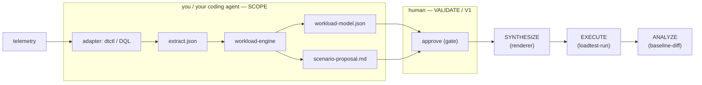

# The workload-model engine

The **engine** is the deterministic core of SCOPE: a standalone, dependency-light
program. It is **backend- and tool-agnostic**: it reads a *neutral telemetry extract*
(JSON) and emits a G0-gated `workload-model.json` plus a human-readable
`scenario-proposal.md`. It never talks to Dynatrace or to a load tool — a backend
adapter (e.g. the `dtctl`/DQL pack) produces the extract; a renderer skill turns the
approved model into a runnable test.

- **Where it lives:** `skills/workload-model/` (SKILL.md + `scripts/` + `tests/`).
- **Language:** Python 3.12.
- **Runtime dependency:** `jsonschema` only (bundled into the released binaries and the
  Docker image).
- **Interface:** reads an extract JSON, writes `workload-model.json` +
  `scenario-proposal.md` to an output directory, supports `--mode agentic|commerce`.

> The released `workload-engine` binary and the
> `ghcr.io/henrikrexed/ai-performance-testing` Docker image **package this skill** so you
> can run SCOPE without a Python toolchain. From source you run the skill directly (see
> §1 *From source*). Binaries and the image are produced by the `release` workflow —
> there is nothing to build by hand.

---

## 1. Install

Pick one. Released artifacts are published per version tag on the
[**Releases**](https://github.com/henrikrexed/AI-Performance-Testing/releases) page by the
[`release` workflow](../.github/workflows/release.yml).

### Linux

```bash
# amd64 (use workload-engine-linux-arm64 on ARM hosts)
VERSION=v0.1.0
curl -fsSL -o workload-engine \
  "https://github.com/henrikrexed/AI-Performance-Testing/releases/download/${VERSION}/workload-engine-linux-amd64"
chmod +x workload-engine
sudo mv workload-engine /usr/local/bin/
workload-engine --help
```

### macOS

```bash
VERSION=v0.1.0
# Apple Silicon: darwin-arm64 · Intel: darwin-amd64
curl -fsSL -o workload-engine \
  "https://github.com/henrikrexed/AI-Performance-Testing/releases/download/${VERSION}/workload-engine-darwin-arm64"
chmod +x workload-engine
# first run on a downloaded binary: clear the quarantine flag
xattr -d com.apple.quarantine workload-engine 2>/dev/null || true
sudo mv workload-engine /usr/local/bin/
workload-engine --help
```

### Windows (PowerShell)

```powershell
$Version = "v0.1.0"
Invoke-WebRequest `
  -Uri "https://github.com/henrikrexed/AI-Performance-Testing/releases/download/$Version/workload-engine-windows-amd64.exe" `
  -OutFile "workload-engine.exe"
.\workload-engine.exe --help
```

### Docker

The image is published multi-arch (amd64 + arm64) to GHCR:

```bash
docker pull ghcr.io/henrikrexed/ai-performance-testing:latest   # or :v0.1.0
# mount a working directory; extract.json goes in, results come out under ./out
docker run --rm -v "$PWD":/work \
  ghcr.io/henrikrexed/ai-performance-testing:latest \
  --extract /work/extract.json --out /work/out
```

### Kubernetes

Run the engine as a one-shot `Job`, mounting the extract via a `ConfigMap` and
collecting output from a volume (or an `emptyDir` + a sidecar/`kubectl cp`). Minimal
manifest:

```yaml
apiVersion: batch/v1
kind: Job
metadata:
  name: workload-model
spec:
  backoffLimit: 0
  template:
    spec:
      restartPolicy: Never
      containers:
        - name: engine
          image: ghcr.io/henrikrexed/ai-performance-testing:v0.1.0
          args: ["--extract", "/work/extract.json", "--out", "/work/out"]
          volumeMounts:
            - { name: extract, mountPath: /work/extract.json, subPath: extract.json }
            - { name: out,     mountPath: /work/out }
      volumes:
        - name: extract
          configMap:
            name: workload-extract      # kubectl create configmap workload-extract --from-file=extract.json
        - name: out
          emptyDir: {}
```

```bash
kubectl create configmap workload-extract --from-file=extract.json
kubectl apply -f job.yaml
kubectl wait --for=condition=complete job/workload-model --timeout=120s
kubectl logs job/workload-model            # prints the G0 report + PASS/FAIL
```

> The image runs as a non-root user and needs no network or cluster permissions — it is
> pure compute over the extract you give it.

### From source (Python)

```bash
git clone https://github.com/henrikrexed/AI-Performance-Testing.git
cd AI-Performance-Testing/skills/workload-model
pip install "jsonschema>=4,<5"

# bundled synthetic example: extract -> G0-validated model + proposal
python3 scripts/build_example.py
cat out/example-frontend/scenario-proposal.md

python3 -m pytest -q        # the engine's own test suite
```

---

## 2. Use — the engine in the loop

The engine owns **SCOPE**. It is one stop in the methodology's
`SCOPE → VALIDATE → SYNTHESIZE → EXECUTE → ANALYZE` loop (full detail in
[`methodology.md`](methodology.md)). The engine's job is to produce a model that a human
can approve.



### Step 1 — produce a neutral extract (adapter, outside the engine)

Point your backend adapter at a **clean telemetry window** `(service, timeframe,
environment)` and capture the facts the engine needs — journeys/span-trees, archetype
split, per-minute arrival counts, baselines. The reference adapter is the `dtctl`/DQL
pack — see [`requirements.md`](requirements.md) §2 and the `skills/workload-model`
SKILL.md; any backend that emits the same JSON shape works.
`skills/workload-model/fixtures/example_extract.json` is a complete synthetic extract
showing the exact schema.

### Step 2 — run the engine (SCOPE)

```bash
# released binary
workload-engine --extract extract.json --out ./out --mode agentic
# from source, equivalently:
#   (cd skills/workload-model && python3 scripts/build_example.py)
```

- `--mode agentic` splits **Agentic vs. Conversational** turns on the `execute_tool`
  terminal signal; `--mode commerce` splits **Buyer vs. Browser** on the order-terminal
  service. Same engine, different terminal signal.
- **Outputs land in the output dir:**
  - `workload-model.json` — the schema-valid (§4 v1.1) model: journeys + weights,
    open/closed arrival profile with Little's-Law check, payload pools, and hard caps.
  - `scenario-proposal.md` — the human-readable proposal (what was analyzed, journeys,
    arrival profile, payload strategy, where it will run, risks, decision requested).
- The engine **self-checks with the G0 gate** and prints the result. It **exits `0`
  only if G0 passes**, non-zero otherwise — so it is safe to gate a pipeline on the exit
  code.

### Step 3 — VALIDATE (the mandatory human gate, V1)

**No test runs before a human approves the model.** A person reads
`scenario-proposal.md` and approves, adjusts, or rejects. Approval is **bound to the
model revision** — there is no agent self-approval, and any later edit invalidates a
prior approval. This gate is the point of the whole methodology; keep it.

### Step 4 — SYNTHESIZE / EXECUTE / ANALYZE (downstream skills)

Once approved, hand `workload-model.json` to a renderer skill
(`skills/k6-synthesis`, `jmeter-synthesis`, `locust-synthesis`, `gatling-synthesis`) →
a runnable test where every request carries `baggage: synthetic=true`. Then
`skills/loadtest-run` executes it under allowlist + hard caps + automatic abort, and
`skills/baseline-diff` compares the run shape against the observed baseline (V3), deciding
accept / iterate (parameter-only, ≤3×) / escalate.

---

## 3. Troubleshooting

| Symptom | Cause / fix |
|---|---|
| `G0 FAIL` + non-zero exit | One or more G0 criteria failed — read the printed `checks[]`; usually a coverage gap or an unlinked step in the extract. |
| `jsonschema not importable` in the G0 report | Only happens from-source without the dep — `pip install jsonschema`. Binaries and the image bundle it. |
| macOS "cannot be opened / unidentified developer" | `xattr -d com.apple.quarantine workload-engine` (binaries are unsigned). |
| Docker: `--out` empty on the host | Mount a writable host dir to `/work` and point `--out` inside it (`--out /work/out`). |

See [`methodology.md`](methodology.md) for the full gate and safety specifications.
