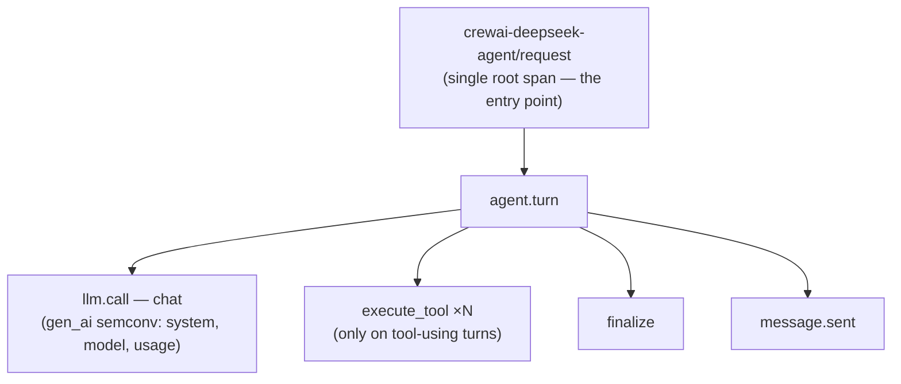

# Tutorial demo component — CrewAI + DeepSeek agent app

A small, self-contained **AI agent service** for practicing the AI-Performance-Testing
loop. One endpoint (`POST /request`) runs a single agent turn and emits a deterministic
OpenTelemetry span tree:



Two deterministic turn types, which the SCOPE stage will rediscover as two behavioral
archetypes:

| Turn | Request | Trace contains | Archetype |
|---|---|---|---|
| `turn_type=tool` | a question needing a tool | `execute_tool` spans | **Agentic** |
| `turn_type=chat` | a pure-LLM question | no `execute_tool` | **Conversational** |

The tools are hermetic (no outbound network calls): `web_search` returns deterministic
pseudo-results, `calculator` evaluates a whitelisted arithmetic expression. Sustained
load only costs you DeepSeek tokens.

```
app/        FastAPI service (CrewAI agent, OTel SDK, DeepSeek via LiteLLM)
k8s/        namespace, secret template, collector, deployment, service
collector/  standalone collector config for the local (no-k8s) path
loadgen/    k6 baseline-traffic driver + prompt bank
```

## Prerequisites

- A **Dynatrace** environment (a free trial works) — you need:
  - an **ingest token** with scope `ingestion:otlp:write` (component telemetry), and
  - a **read-only token** with `storage:spans:read`, `storage:logs:read` (DQL queries in
    the later tutorial stages — see the root `.env.example`).
- A **DeepSeek API key** (https://platform.deepseek.com — cheap; the tutorial window
  costs cents).
- Path A: a Kubernetes cluster + a container registry it can pull from, `kubectl`, `docker`.
- Path B (fallback): just `docker` on your machine.
- `k6` for the traffic driver (https://grafana.com/docs/k6/latest/set-up/).

## Path A — Kubernetes

### Build & push the image

```sh
export REGISTRY=<your-registry>/<project>     # must be pullable by your cluster
cd app
docker build -t "$REGISTRY/crewai-deepseek-agent:0.1.0" .
docker push "$REGISTRY/crewai-deepseek-agent:0.1.0"
sed -i.bak "s#REGISTRY/crewai-deepseek-agent:0.1.0#$REGISTRY/crewai-deepseek-agent:0.1.0#" ../k8s/deployment.yaml
```

### Create secrets (never commit real values)

```sh
kubectl apply -f k8s/namespace.yaml

kubectl -n agentapp create secret generic deepseek-api \
  --from-literal=apiKey="$DEEPSEEK_API_KEY"

kubectl -n agentapp create secret generic dt-otlp \
  --from-literal=tenantUrl="https://<your-environment>.live.dynatrace.com/api/v2/otlp" \
  --from-literal=apiToken="$DT_OTLP_API_TOKEN"
```

`k8s/secret.example.yaml` documents the same shape — use it as a reference, not with
real values.

### Deploy

```sh
kubectl apply -f k8s/collector.yaml
kubectl apply -f k8s/deployment.yaml
kubectl apply -f k8s/service.yaml
kubectl -n agentapp rollout status deploy/agent-collector
kubectl -n agentapp rollout status deploy/crewai-deepseek-agent
```

## Path B — local Docker (no cluster)

Run the collector container first, then the app pointed at it:

```sh
# 1. collector (exports to your Dynatrace tenant)
docker run -d --name agent-collector -p 4318:4318 \
  -v "$(pwd)/collector/local-collector.yaml":/etc/collector.yaml:ro \
  -e DT_OTLP_ENDPOINT="https://<your-environment>.live.dynatrace.com/api/v2/otlp" \
  -e DT_API_TOKEN="$DT_OTLP_API_TOKEN" \
  otel/opentelemetry-collector-contrib:0.135.0

# 2. app
cd app
docker build -t crewai-deepseek-agent:0.1.0 .
docker run -d --name crewai-deepseek-agent -p 8080:8080 \
  -e OTEL_EXPORTER_OTLP_ENDPOINT=http://<collector-host>:4318 \
  -e DEEPSEEK_API_KEY="$DEEPSEEK_API_KEY" \
  crewai-deepseek-agent:0.1.0
```

`<collector-host>` is `host.docker.internal` from another container on the same machine
(or `localhost` if you run the app on the host instead of in Docker).

## Smoke test (validate the span shape BEFORE the baseline window)

```sh
# tool-using turn -> expect execute_tool spans
curl -s localhost:8080/request -H 'Content-Type: application/json' \
  -d '{"prompt":"What is 3 * (47 + 19)?","turn_type":"tool"}' | jq .

# pure-LLM turn -> no execute_tool spans
curl -s localhost:8080/request -H 'Content-Type: application/json' \
  -d '{"prompt":"In one sentence, what is observability?","turn_type":"chat"}' | jq .
```

Both must return `{"answer": "...", "turn_type": ...}`. Then confirm in your Dynatrace
environment (Notebooks → run DQL):

```dql
fetch spans, from:-15m
| filter service.name == "crewai-deepseek-agent"
| summarize c = count(), by:{span.name}
| sort c desc
```

Expect rows for `crewai-deepseek-agent/request`, `agent.turn`, `llm.call`, `chat`,
`execute_tool`, `finalize`, `message.sent`.

> If `llm.call`/`chat` spans are missing, CrewAI's `LLM.call` signature drifted from the
> pinned version — bump `crewai` within the same minor in `app/requirements.txt` and
> re-smoke. The `execute_tool` / `request` spans (the signals the methodology strictly
> needs) do not depend on that signature.

## Generate the baseline window

This produces the "production-like" telemetry that the SCOPE stage will model. The
driver uses an **open-model** constant arrival rate so arrivals stay decoupled from
(very variable) LLM latency:

```sh
cd loadgen
BASE_URL=http://localhost:8080 RATE_PER_MIN=20 DURATION=45m TOOL_RATIO=0.30 \
  k6 run driver.js
```

~900 turns at ~30% tool / 70% chat — enough volume for pace/CoV derivation and a
per-turn baseline, with both archetypes well-populated. **Note the start/end
timestamps**; they are the SCOPE extraction window. Do not deploy or otherwise disturb
the service during the window.

The driver defaults (`RATE_PER_MIN`, `DURATION`, `TOOL_RATIO`, `PRE_ALLOC`) can also be
set in your `.env` — see the root `.env.example`.

## Teardown

Path A: `kubectl delete ns agentapp` · Path B: `docker rm -f crewai-deepseek-agent agent-collector`

## Cost & safety notes

- DeepSeek is the only paid dependency; at the tutorial scale expect a few cents.
- The app makes no other outbound calls; tools are hermetic.
- The k6 driver aborts itself if the error rate exceeds 5% (`http_req_failed` threshold).
